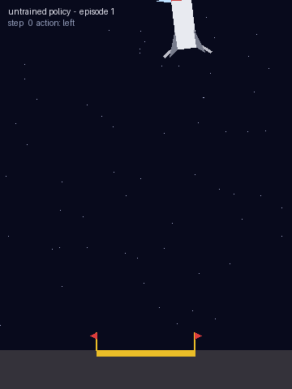
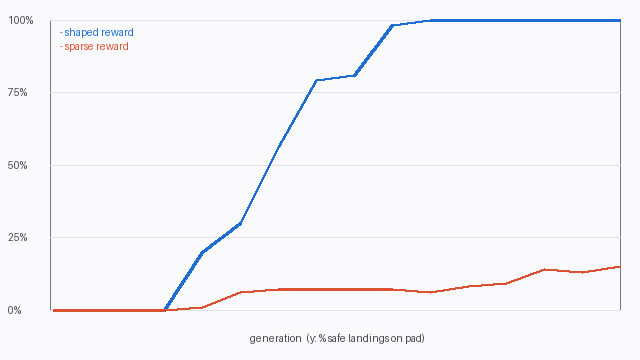

# rocket-lander-rl

Train an AI to land a rocket — a from-scratch Lunar Lander reinforcement-learning
project that runs on a laptop in under a minute, with **reward shaping**.



Only NumPy and Pillow are required (no Box2D, Gymnasium, or PyTorch).

## Run it

```bash
pip install -r requirements.txt
python rocket_lander_rl.py --compare     # shaped vs. sparse reward
```

Outputs go to `out/`: a GIF per reward mode, a learning-curve PNG, and the
trained policy weights. Other flags:

| Flag | Meaning |
|---|---|
| `--no-shaping` | train on the sparse +100 / -100 reward only |
| `--generations N` | training generations (default 150) |
| `--population N` | candidates per generation (default 128) |
| `--seed N` | random seed |
| `--out DIR` | output directory (default `out`) |

## How it works

- **Environment** — 2D rocket with a main engine and two side thrusters.
  Observation: `x, y, vx, vy, angle, angular velocity, left leg, right leg`.
  Actions: noop, left thruster, main engine, right thruster. A soft touchdown
  (low speed, upright) is a landing; anything else is a crash.
- **Reward shaping** — each step pays the *change* in a potential
  (closer to the pad, slower, more upright, legs down) minus a fuel cost, plus
  +100 for a soft landing and -100 for a crash. The sparse variant keeps only
  the +100 / -100.
- **Learner** — evolution strategies (antithetic sampling, centred ranks, Adam)
  on a small MLP policy. The whole population is simulated in parallel as one
  NumPy batch, so training takes seconds.

## Results (seed 0, 150 generations)

| Reward | Safe landings on the pad (500 fresh episodes) | Train time |
|---|---|---|
| Shaped | 100% | ~25 s |
| Sparse | 23% | ~10 s |



The sparse bonus is paid for *any* soft touchdown, not only on the pad, so the
sparse agent learns to land but not to aim: it lands softly about two thirds of
the time, mostly off the pad. Judged on "any safe landing" the gap is smaller
than the 23% headline suggests, though shaping still wins.

## Notes

The physics is custom, so scores are not comparable with Gymnasium's Box2D
`LunarLander`. A hand-written PD controller lands safely in 96–99% of episodes,
which confirms the task is solvable.
